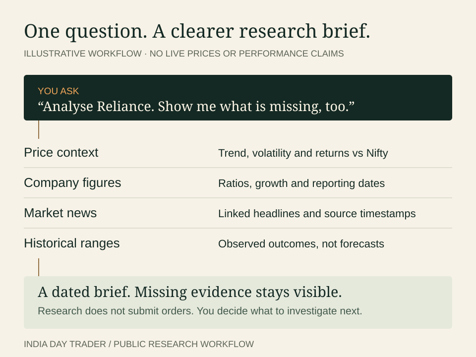

# Day Trader — Indian Market

**An Indian-market research desk inside your AI assistant.** Analyse stocks, prepare Nifty / Sensex / Bank Nifty briefings, follow linked news and test paper-trade plans—with dated sources and missing evidence made visible.

[](https://github.com/kunalshinde1214/Day-Trader-Indian-Market/actions/workflows/ci.yml)


[Install](#install) · [See the workflow](#from-question-to-research) · [Feature matrix](#what-is-implemented) · [Download 0.9.9](https://github.com/kunalshinde1214/Day-Trader-Indian-Market/releases/tag/v0.9.9-broker-workflows-alpha) · [Documentation](#go-deeper)

Created by **Kunal Shinde**. Source-available and free for personal use. Public research needs **no brokerage account or API key**. Broker workflows use **your own account**, with credentials kept locally.

## From question to research



| Ask the skill | What it prepares |
| --- | --- |
| “Analyse Reliance. What data is missing?” | Trend, relative returns, available financial ratios, linked news and historical return ranges |
| “Give me today’s Nifty, Sensex and Bank Nifty briefing.” | Completed-bar context, reference levels and conditional scenarios |
| “What changed in Indian-market news?” | Source-linked headlines, timestamps and disclosure candidates |
| “Scan these stocks for opening-range breakouts.” | Deterministic rule matches with explicit input requirements |
| “Size this paper plan for my ₹2,000 risk budget.” | Whole-unit / whole-lot sizing with configured costs and risk checks |

Historical ranges are **observed outcomes, not forecasts**. A rule match is not a buy/sell recommendation. Reports depend on available history and source coverage; missing data is flagged rather than replaced with demo figures.

## Install

### Claude Code plugin

Requires **Python 3.10+**. In Claude Code:

```text
/plugin marketplace add kunalshinde1214/Day-Trader-Indian-Market
/plugin install india-day-trader@kunal-india-trading
```

Then ask naturally, or use a namespaced command:

```text
/india-day-trader:stock-analysis RELIANCE
/india-day-trader:india-daily
/india-day-trader:nifty
```

There are **16 plugin skills**: eleven trading-workflow roles, four daily aliases and one-stock analysis. See the [command reference](references/commands.md). For other skill-compatible hosts, download the release ZIP, unpack `india-day-trader`, and follow that host’s skill installation process. Claude plugin installation is not a universal installer for other hosts.

### Python CLI

Clone the repository, or open the folder from the [release ZIP](https://github.com/kunalshinde1214/Day-Trader-Indian-Market/releases/tag/v0.9.9-broker-workflows-alpha):

```bash
git clone https://github.com/kunalshinde1214/Day-Trader-Indian-Market.git india-day-trader
cd india-day-trader
python scripts/daily.py nifty --demo
python scripts/stock_analysis.py RELIANCE
python scripts/daily.py india-daily --collect-public
```

The `--demo` command uses **fictional demo data**. The last two fetch public data and need internet access. Use `python3` on macOS/Linux or `py` on Windows if `python` is unavailable. Core CLI workflows use the Python standard library; optional streaming and document-extraction paths have [additional requirements](references/operations.md).

For a ZIP install, download both release assets into the same folder. Before extracting, run `sha256sum -c india-day-trader-0.9.9-broker-workflows-alpha.zip.sha256` on Linux, or `shasum -a 256 -c india-day-trader-0.9.9-broker-workflows-alpha.zip.sha256` on macOS. In Windows PowerShell, run `Get-FileHash .\india-day-trader-0.9.9-broker-workflows-alpha.zip -Algorithm SHA256` and compare the hash with the `.sha256` file. Extract the ZIP, open its `india-day-trader` folder, then run the Python commands above.

## What is implemented

**0.9.9 public alpha** includes the following. “Implemented” means code and offline checks exist; it does not mean a user’s account or production environment has been accepted.

| Capability | Available now | Boundary |
| --- | --- | --- |
| Stock research | Price context, Nifty comparison, technicals, available ratios and news | Source availability and financial-statement coverage vary |
| Daily briefings | India daily, Nifty, Sensex, Bank Nifty; pre-open / intraday / close modes | Public feeds can be delayed; membership and breadth are partial |
| Scanning & paper plans | Six scanners; one-/five-minute ORB and custom levels; replay, sizing and risk checks | Other scanner rules remain five-minute; results are research |
| News & filings | RSS discovery, deduplication, attachment extraction, supported XBRL and filing backlog | Not comprehensive exchange or historical coverage |
| Repeated collection | Bounded foreground runs, saved reports, shared backlog and stop latch | No automatic service installation; partial sources stay partial |
| Broker data | Kite, Upstox, Dhan, Angel One and FYERS adapters | User login, entitlements and account-specific checks required |
| Carry accounting | Supported subsets across five broker collectors | T1, pledged, MTF and unresolved adjustments block |
| Carry reducing orders | **Kite, Upstox and Dhan** exits, stop-limits and cancellation | Human-operated; no new mixed-inventory entries; Angel/FYERS execution pending |
| Risk models | Depth stress; Kite cash-equity depth sampling; basket prefixes, scenarios and quantity grids | Other-broker basket margin and queue/market-impact models pending |
| Protection | Experimental single-instrument intraday runner, explicitly human-armed and bounded | Disabled by default; not production-accepted or guaranteed to flatten |
| User setup | Disabled profiles, read-only probes and acceptance-evidence inventory | Each user supplies and verifies their own environment |

The paper workflow is **scan → plan → replay → size → risk → ticket**. Replay supports independent, contiguous-block and whole-session sampling; quantity grids explore explicit partial-fill combinations rather than assuming every basket fills together.

## Your account. Your controls.

The publisher does not supply a trading account. Public research works without one. To prepare your own broker workflow:

```bash
python scripts/user_setup.py --broker upstox --account-id YOUR_NONSECRET_ACCOUNT_ID --out trader/live-profile.json
```

This creates a **disabled** profile and refuses overwrite. It does not log in, save credentials or mark acceptance passed. Follow [user setup](references/user-setup.md) and [acceptance evidence](references/acceptance-evidence.md); keep keys and tokens out of chat, Git and reports.

Ordinary execution requires two human confirmations and fresh checks. The separate [protection runner](references/protection-controller.md) uses a human-armed, expiring authorization with action caps. Never enable it merely to try a demo. Ambiguous requests stay locked without automatic resubmission. Stop-limits and cutoff exits may not fill.

## Release evidence, not performance claims

This checkpoint has **781 passing offline tests**, including simulated broker responses and failure cases. Release validation checks Python syntax, JSON, local links and an explicit packaging allowlist. GitHub CI tests Python **3.10, 3.12 and 3.13**; the [release](https://github.com/kunalshinde1214/Day-Trader-Indian-Market/releases/tag/v0.9.9-broker-workflows-alpha) includes a ZIP and SHA-256 checksum.

```bash
python scripts/release.py --check
```

Offline tests do **not** prove live broker acceptance, profitability or production reliability. No publisher brokerage account, real acceptance trade or production service was used. See [release status](references/release-status.md) for the exact scope.

## Go deeper

| Explore | Documentation |
| --- | --- |
| Research | [Daily reports](references/daily.md) · [News](references/india-news.md) · [Public workflows](references/public-workflows.md) |
| Trading logic | [Setup definitions](references/setups.md) · [Execution](references/execution.md) · [Risk/data expansion](references/india-expansion.md) |
| Carry execution | [Kite](references/mixed-inventory-exits.md) · [Upstox](references/upstox-execution.md) · [Dhan](references/dhan-execution.md) |
| Project | [Changelog](CHANGELOG.md) · [Requirements](references/requirements.md) · [Contributing](CONTRIBUTING.md) · [Security](SECURITY.md) |

**Still on the roadmap:** Angel/FYERS carry execution; unsupported inventory and settlement/corporate-action automation; new mixed-inventory entries; comprehensive BSE/calendar/surveillance/filing coverage; deeper execution-cost and other-broker margin models; broader protection coordination. User account acceptance is separate from this engineering roadmap.

## License & responsible use

**Source-available, not open source.** Original contributions are free for personal use under the [personal-use license](LICENSE). Redistribution, resale and hosted services require permission under those terms. Third-party MIT rights remain intact; this project builds on Jake Schincariol’s [day-trader-skill](third-party/day-trader-skill.LICENSE). See [third-party notices](THIRD_PARTY_NOTICES.md).

Use at your own risk. This is research software, not investment advice; trading can lose money. Follow your broker’s permissions and applicable requirements. Read the [risk disclosure](RISK_DISCLOSURE.md). Not affiliated with or endorsed by NSE, BSE, SEBI or any broker.
