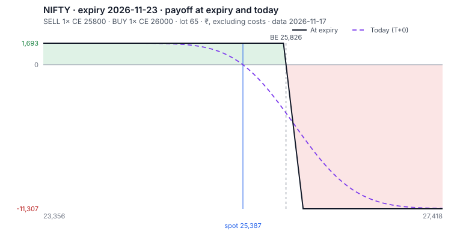

# Day Trader — Indian Market

**An Indian-market research desk inside your AI assistant.** Analyse stocks, prepare Nifty / Sensex / Bank Nifty briefings, follow linked news and test paper-trade plans—with dated sources and missing evidence made visible.

[](https://github.com/kunalshinde1214/Day-Trader-Indian-Market/actions/workflows/ci.yml)


[Install](#install) · [See the workflow](#from-question-to-research) · [Feature matrix](#what-is-implemented) · [Download 1.5.1](https://github.com/kunalshinde1214/Day-Trader-Indian-Market/releases/tag/v1.5.1) · [Documentation](#go-deeper)

Created by **Kunal Shinde**. Source-available and free for personal use. Public research needs **no brokerage account or API key**. Broker workflows use **your own account**, with credentials kept locally.

**New in 1.5.0:** "why did the market move" with index drivers and dated headlines, one sector's stocks (`--sector`), index performance over a period (`--period`), a market-mood view, weekend and holiday reports, stock figures cross-checked with NSE filings, shareholding and pledge trends, after-close option chains, indicative SPAN margin, and position sizing from a stock name. See the [changelog](CHANGELOG.md) and [release status](references/release-status.md).

## From question to research


| Ask the skill | What it prepares |
| --- | --- |
| “Find Nifty 50 stocks with ROE above 20% and P/E below 25.” | A ranked table with P/E, P/B, ROE, margins, debt, growth and 1-year return, plus which stocks lacked data |
| “Review my portfolio. How much tax if I sell everything?” | P&L, weights, sector exposure, concentration, and short/long-term capital-gains estimates from your tradebook |
| “Reliance ka analysis karo” | The same reports, explained in Hindi or Hinglish |
| “Show the Nifty option chain: PCR, max pain and where OI is building.” | Chain around the money with OI, OI change, IV and delta; PCR, max pain, OI walls, build-up, expected move and India VIX |
| “What's the payoff of a 25800/26000 – 25000/24800 iron condor?” | Net premium, max profit and loss, breakevens, position Greeks and a shaded payoff chart |
| “Analyse Reliance. What data is missing?” | Trend, relative returns, available financial ratios, linked news and historical return ranges |
| “Give me today’s Nifty, Sensex and Bank Nifty briefing.” | Completed-bar context, reference levels and conditional scenarios |
| “What changed in Indian-market news?” | Source-linked headlines, timestamps and disclosure candidates |
| “Scan these stocks for opening-range breakouts.” | Deterministic rule matches with explicit input requirements |
| “Size this paper plan for my ₹2,000 risk budget.” | Whole-unit / whole-lot sizing with configured costs and risk checks |

Historical ranges are **observed outcomes, not forecasts**. A rule match is not a buy/sell recommendation. Reports depend on available history and source coverage; missing data is flagged rather than replaced with demo figures.

## See it in action

Real output from version 1.5.1 on Tue 24 Nov 2026, an NSE holiday, so the figures are from the Mon 23 Nov session. Trimmed, otherwise unedited; figures are as of that date, not current.

**“Analyse Reliance. Is it cheap?”** (`stock_analysis.py RELIANCE --summary`):

```text
Reliance Industries Limited (RELIANCE.NS) — prices as of 2026-11-23
Valuation: P/E 22.3 (trailing 12 months); on latest annual EPS 22.6, cheaper than on 89% of trading days since Nov 2021 (usual range 24.4–29.4) — but that EPS includes one-offs: without them about 25.0, cheaper than on 70% of days (estimate, see ⚠ below); P/B 1.94; market cap ₹18.28 lakh cr.
Quality and growth: ROE 9.2%; debt/equity 0.43 at 30 Sep 2026; revenue +9.6%, EPS +16.0% (FY2026 vs FY2025; EPS about +4.9% without one-offs, estimate); 3-year CAGR FY2023–FY2026: revenue +6.4% a year, profit +6.6% a year (NSE consolidated results filings).
Sum of parts: 64.48% of Jio Platforms (JPL) × its market cap ₹12.61 lakh cr = ₹8.13 lakh cr — 44% of Reliance's own market cap (estimate).
Price ₹1,351.00 (-1.92% on the day); 1 year -11.1% vs Nifty -2.6%; -16.2% from the 52-week high.
⚠ FY2026 earnings include one-offs: other income in the Jun 2025 quarter was ₹15,119 cr, about ₹10,210 cr above its usual ₹4,910 cr … check that quarter's results release.
```

**“Why did the market fall?”** (`market_movers.py --summary`):

```text
Market closed today (Tue 24 Nov 2026: Prakash Gurpurb Sri Guru Nanak Dev) — figures are from the last session, Mon 23 Nov 2026.
Nifty 50 closed down 450.95 points (-1.75%) at 25,349.65 on Mon 23 Nov 2026 (NSE).
- Breadth: 11 of 50 Nifty stocks up, 39 down. Nifty Midcap 150 -0.92%, Nifty Smallcap 250 -0.69%.
- Sectors: strongest Nifty IT +1.69%; weakest Nifty Metal -3.68%, Nifty PSU Bank -3.25%, Nifty Private Bank -3.19%.
- Biggest drags (est. index points): HDFCBANK -93.3 pts, ICICIBANK -84.3 pts, RELIANCE -38.2 pts, AXISBANK -35.7 pts.
- Check: these estimates add up to -449.4 points vs the official -450.9.
- FII/FPI net +₹5,672.99 cr (net buyers), DII net -₹2,760.12 cr (net sellers) (provisional NSE data).
- Mood context (not a forecast): Nifty 50 P/E 20.65 vs its past-year range 19.05–22.81; India VIX 17.70 vs its 52-week range 8.72–28.91.
```

**“Nifty ka option chain dikhao”** (`fno.py chain NIFTY --summary`):

```text
NIFTY options, expiry 2026-12-01 (weekly, 8.0 days) — data 2026-11-23 close (NSE F&O bhavcopy, end of day)
- PCR (OI) 0.70 (-0.17 vs 2026-11-20)
- Max pain 25,500 — 0.6% above spot (the Mon 23 Nov close)
- Expected move to expiry ±506.45 (2.0%) by ATM straddle; 68% implied range 24,737–26,008 around the forward 25,373
Next session — Wed 25 Nov: 1-sigma ±270 (1.07%): 25,079–25,620; OI walls near spot: calls 26,000, 25,500 · puts 25,000, 24,800
```

**“Payoff of selling the 25800 call and buying the 26000 call”** (`fno.py payoff NIFTY --leg SELL:CE:25800:1 --leg BUY:CE:26000:1 --chart …`, 17 Nov 2026 data): net credit ₹1,693, maximum loss ₹11,307, breakeven 25,826, probability of profit 81.6% as implied by option prices.



## Install

### Claude Code plugin

Requires **Claude Code**, **Git** and **Python 3.10+** installed. For a first-time install, paste this single line into your **terminal** (macOS/Linux Bash or Zsh, Windows PowerShell 7+, or Command Prompt):

```bash
claude plugin marketplace add kunalshinde1214/Day-Trader-Indian-Market && claude plugin install india-day-trader@kunal-india-trading
```

This registers the marketplace and installs all 12 plugin skills for your user account. The install step runs only if marketplace registration succeeds. Open a new Claude Code session after installation. It does not configure brokerage credentials or enable live trading.

<details>
<summary>Windows PowerShell 5.1, or marketplace already added?</summary>

Windows PowerShell 5.1 does not support `&&`. Use this one-line equivalent:

```powershell
claude plugin marketplace add kunalshinde1214/Day-Trader-Indian-Market; if ($LASTEXITCODE -eq 0) { claude plugin install india-day-trader@kunal-india-trading }
```

If you already added this marketplace, run only `claude plugin install india-day-trader@kunal-india-trading`.

</details>

Alternatively, inside an existing Claude Code session, run these two commands separately:

```text
/plugin marketplace add kunalshinde1214/Day-Trader-Indian-Market
/plugin install india-day-trader@kunal-india-trading
```

Then ask naturally, or use a namespaced command:

```text
/india-day-trader:nifty
/india-day-trader:india-daily
/india-day-trader:stock RELIANCE
/india-day-trader:fno NIFTY
```

There are **12 plugin skills**: the daily commands `nifty`, `sensex`, `banknifty` and `india-daily`, plus `stock`, `fno`, `screener`, `portfolio`, `market`, `news`, `trade-plan` and `broker`. In Claude Code they are typed with the plugin prefix, for example `/india-day-trader:nifty`; you can also just ask in plain English, Hindi or Hinglish ("Nifty aaj kaisa hai"). See the [command reference](references/commands.md). For other skill-compatible hosts, download the release ZIP, unpack `india-day-trader`, and follow that host’s skill installation process. Claude plugin installation is not a universal installer for other hosts.

### Python CLI

Clone the repository, or open the folder from the [latest release ZIP](https://github.com/kunalshinde1214/Day-Trader-Indian-Market/releases/latest):

```bash
git clone https://github.com/kunalshinde1214/Day-Trader-Indian-Market.git india-day-trader
cd india-day-trader
python scripts/daily.py nifty --demo
python scripts/stock_analysis.py RELIANCE
python scripts/daily.py india-daily --collect-public
```

The `--demo` command uses **fictional demo data**. The last two fetch public data and need internet access. Use `python3` on macOS/Linux or `py` on Windows if `python` is unavailable. Core CLI workflows use the Python standard library; optional streaming and document-extraction paths have [additional requirements](references/operations.md).

For a ZIP install, download both release assets (`india-day-trader-1.5.1.zip` and `india-day-trader-1.5.1.zip.sha256`) into the same folder. Before extracting, run `sha256sum -c india-day-trader-1.5.1.zip.sha256` on Linux, or `shasum -a 256 -c india-day-trader-1.5.1.zip.sha256` on macOS. In Windows PowerShell, run `(Get-FileHash .\india-day-trader-1.5.1.zip -Algorithm SHA256).Hash` and compare it with the first value in the `.sha256` file (PowerShell prints it in capitals; the comparison is not case-sensitive). For a later release, replace 1.5.1 with that version. Extract the ZIP, open its `india-day-trader` folder, then run the Python commands above.

## What is implemented

Version 1.5.1 includes the following. “Implemented” means code and offline tests exist. It does not mean coverage of every exchange source, or that any user's broker account or production environment has been accepted.

Two things the scripts do not do automatically:

- **Exchange coverage is partial.** Scripts read NSE's public files and APIs (closing levels, bhavcopy, F&O and SPAN files, announcements, shareholding and results filings, surveillance and F&O-ban lists). BSE notices and filings, special sessions, emergency circulars, concalls and macro events are looked up by [web research](references/web-research.md) when you ask. That is a cited search at request time, not an automatic or comprehensive feed, and a search can miss things.
- **Broker workflows are yours to validate.** The [broker connectors](references/broker-connectors.md) and built-in adapters are tested against recorded and simulated responses only. Each user confirms their own account before relying on them.

Older capabilities (carry accounting and reducing orders, [inventory reconciliation](references/inventory-book.md), [mixed cash entries](references/mixed-inventory-entries.md), [exchange observations](references/exchange-coverage.md), [historical evidence](references/historical-evidence.md), [announcement backfill](references/announcement-history.md) and [closing reports](references/closing-context.md)) are unchanged; see [release status](references/release-status.md).

| Capability | Available now | Boundary |
| --- | --- | --- |
| Market moves | Direction, sectors, the stocks that moved the index (estimated points, checked against the official change), breadth, VIX, FII/DII and NSDL flows, dated headlines and cues; one sector's stocks (`--sector`); indices over a week, month or year (`--period`); a mood view with Nifty P/E and VIX against their past-year ranges; weekend and holiday reports | Index weights are estimates anchored to the monthly NSE Indices factsheet; headlines are unverified possible causes |
| Daily briefings | India daily, Nifty, Sensex, Bank Nifty; live NSE levels in market hours, close and closed-day modes with next-session levels | Sensex is an estimate or Yahoo quote (BSE blocks scripts); Yahoo data is unofficial and about 15 minutes delayed |
| Stock research | Price context, technicals, ratios cross-checked with NSE consolidated filings, P/E history adjusted for bonuses and splits, one-offs stripped, 3-year growth, business peers, sum of parts, `--compare`, ranked news | Yahoo financials can be stale or wrong; the report flags disagreements it detects, not every error |
| Shareholding | Latest pattern, promoter pledge and encumbrance trend over up to 8 quarters, SAST filings, fund houses matched across quarters | NSE filings only; BSE-only deals are pointed to, not read |
| Screening | Nifty 50/100/200/500, Next 50, midcap, smallcap and sector indices; 15+ fundamental and momentum fields, dividend preset, `--exclude-sector` | Yahoo fundamentals; smaller companies often have gaps, listed separately |
| Portfolio review | Holdings from a broker connector, Zerodha CSV or JSON; P&L, XIRR vs Nifty, sectors, concentration; bonuses, splits and demergers applied; capital-gains estimates under the Income-tax Act 2025 with set-offs | Tax figures are estimates; surcharge, grandfathering and business income are not modelled |
| F&O analytics | Option chain (NSE's closing chain after 15:30), OI and build-up, PCR, max pain, IV and Greeks (Black-76), payoffs and strike grids incl. iron fly, relative strikes, indicative SPAN + exposure margin from NSE Clearing's files with the expiry-day extra shown separately | End-of-day NSE data by default; live chains come from your broker connector; your broker's margin is final |
| Position sizing | From a stock name, % or N-day-low stop, delivery and intraday side by side, Indian charges included | Uses the last close or live price as labelled |
| Scanning & paper plans | Six scanners and custom levels at one/five minutes; replay, sizing and risk checks | Regular-session rules; pre-open/regime and broader special-session models pending |
| News & filings | RSS discovery, bounded NSE backfill, attachment discovery, supported XBRL and filing backlog; BSE and anything else via web research | Web facts are cited research, never risk-check evidence |
| Repeated collection | Bounded foreground runs, saved reports, shared backlog and stop latch | No automatic service installation; partial sources stay partial |
| Broker data | Your broker's own connector (e.g. Zerodha Kite, Upstox, Dhan, Groww) or the built-in Kite, Upstox, Dhan, Angel One and FYERS adapters | You connect and verify your own account |
| Carry accounting | Supported subsets across five broker collectors | T1, pledged, MTF and unresolved adjustments block |
| Carry reducing orders | **All five brokers**: supported carry exits, stop-limits and cancellation | Human-operated; unsupported inventory remains blocked |
| Mixed entries | MIS cash entries (opt-in shorts) alongside long CNC and signed MIS exposure | Disabled by default; no new carry, derivative or restricted-inventory entries |
| Risk models | Depth stress; five-broker cash depth and basket margins; quantity-dependent replay costs; passive-fill and collateral stress scenarios | Scenarios use your stated assumptions; they are not calibrated predictions |
| Protection | Intraday and carry-aware runners with group coordination, explicitly human-armed, expiring and action-capped | Disabled by default; only cancels or reduces; fills are never guaranteed |
| User setup | Disabled profiles, read-only probes and acceptance-evidence inventory | Each user supplies and verifies their own environment |

The paper workflow is **scan → plan → replay → size → risk → ticket**. Replay supports independent, contiguous-block and whole-session sampling; quantity grids explore explicit partial-fill combinations rather than assuming every basket fills together.

## Your account. Your controls.

The publisher does not supply a trading account. Public research works without one. The easiest way to add yours is your broker's own connector in Claude's connector settings; the skill uses it to read your holdings, positions, funds and quotes, and never places orders through it on its own ([broker connectors](references/broker-connectors.md)). To use the built-in adapters instead:

```bash
python scripts/user_setup.py --broker upstox --account-id YOUR_NONSECRET_ACCOUNT_ID --out trader/live-profile.json
```

This creates a **disabled** profile and refuses overwrite. It does not log in, save credentials or mark acceptance passed. Follow [user setup](references/user-setup.md) and [acceptance evidence](references/acceptance-evidence.md); keep keys and tokens out of chat, Git and reports.

Ordinary execution requires two human confirmations and fresh checks. The separate [protection runner](references/protection-controller.md) uses a human-armed, expiring authorization with action caps. Never enable it merely to try a demo. Ambiguous requests stay locked without automatic resubmission. Stop-limits and cutoff exits may not fill.

## Release evidence, not performance claims

The 1.5.1 release has **1,883 passing offline tests**, including recorded and simulated exchange and broker responses and failure cases; locally they also pass with network access blocked. Release validation checks Python syntax, JSON, local links and an explicit packaging allowlist. GitHub CI tests Python **3.10, 3.12 and 3.13**; the [release](https://github.com/kunalshinde1214/Day-Trader-Indian-Market/releases/tag/v1.5.1) includes a ZIP and SHA-256 checksum. Published CI results do not validate later local edits.

Before release, separate AI reviewer agents scored answers to 45 everyday questions (30 of them not used during development) against a fixed rubric, and spot-checked figures against NSE files, company filings, Screener.in and a broker margin calculator. On the last unseen set they averaged about 8 out of 10 before the final fixes, which were not re-scored. See [release status](references/release-status.md) for the method and its limits.

```bash
python scripts/release.py --check
```

Offline tests and these scores do **not** prove live broker acceptance, comprehensive exchange coverage, future source availability, profitability or production reliability. No publisher brokerage account, real acceptance trade or production service was used. See [release status](references/release-status.md) for the exact scope.

## Go deeper

| Explore | Documentation |
| --- | --- |
| Research | [Daily reports](references/daily.md) · [News](references/india-news.md) · [Public workflows](references/public-workflows.md) · [Web research](references/web-research.md) · [Broker connectors](references/broker-connectors.md) |
| Trading logic | [Setup definitions](references/setups.md) · [Execution](references/execution.md) · [Risk/data expansion](references/india-expansion.md) |
| Carry execution | [Kite](references/mixed-inventory-exits.md) · [Upstox](references/upstox-execution.md) · [Dhan](references/dhan-execution.md) · [Angel/FYERS](references/angel-fyers-execution.md) |
| Project | [Changelog](CHANGELOG.md) · [Requirements](references/requirements.md) · [Contributing](CONTRIBUTING.md) · [Security](SECURITY.md) · [Advanced tools](references/advanced.md) |

**Scope:** research, daily reports, analysis and paper-trading workflows are implemented. Exchange coverage is partial: NSE public data through the scripts, everything else through request-time web research, which is not comprehensive. Broker workflows are tested offline only, and each user validates their own connection. Optional future enhancements are listed in the [completion status](references/completion-tracker.md).

## License & responsible use

**Source-available, not open source.** Original contributions are free for personal use under the [personal-use license](LICENSE). Redistribution, resale and hosted services require permission under those terms. Third-party MIT rights remain intact; this project builds on Jake Schincariol’s [day-trader-skill](third-party/day-trader-skill.LICENSE). See [third-party notices](THIRD_PARTY_NOTICES.md).

Use at your own risk. This is research software, not investment advice; trading can lose money. Follow your broker’s permissions and applicable requirements. Read the [risk disclosure](RISK_DISCLOSURE.md). Not affiliated with or endorsed by NSE, BSE, SEBI or any broker.
