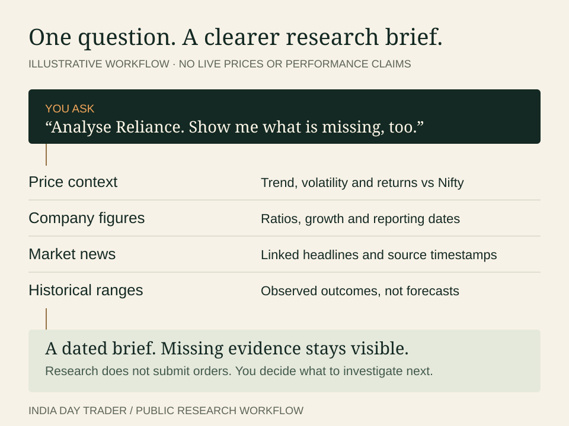

# Day Trader — Indian Market

**An Indian-market research desk inside your AI assistant.** Analyse stocks, prepare Nifty / Sensex / Bank Nifty briefings, follow linked news and test paper-trade plans—with dated sources and missing evidence made visible.

[](https://github.com/kunalshinde1214/Day-Trader-Indian-Market/actions/workflows/ci.yml)


[Install](#install) · [See the workflow](#from-question-to-research) · [Feature matrix](#what-is-implemented) · [Download 1.0.0](https://github.com/kunalshinde1214/Day-Trader-Indian-Market/releases/tag/v1.0.0) · [Documentation](#go-deeper)

Created by **Kunal Shinde**. Source-available and free for personal use. Public research needs **no brokerage account or API key**. Broker workflows use **your own account**, with credentials kept locally.

**Also in 1.0.0 (from 0.10.1):** resumable NSE announcement history, trade-inclusive inventory reconciliation, short MIS entries alongside existing inventory, Dhan basket margins, fill and collateral stress scenarios, and carry-aware protection. See [0.10.1 scope](references/development-progress.md).

## From question to research



| Ask the skill | What it prepares |
| --- | --- |
| “Analyse Reliance. What data is missing?” | Trend, relative returns, available financial ratios, linked news and historical return ranges |
| “Give me today’s Nifty, Sensex and Bank Nifty briefing.” | Completed-bar context, reference levels and conditional scenarios |
| “What changed in Indian-market news?” | Source-linked headlines, timestamps and disclosure candidates |
| “Scan these stocks for opening-range breakouts.” | Deterministic rule matches with explicit input requirements |
| “Size this paper plan for my ₹2,000 risk budget.” | Whole-unit / whole-lot sizing with configured costs and risk checks |

Historical ranges are **observed outcomes, not forecasts**. A rule match is not a buy/sell recommendation. Reports depend on available history and source coverage; missing data is flagged rather than replaced with demo figures.

## Install

### Claude Code plugin

Requires **Claude Code**, **Git** and **Python 3.10+** installed. For a first-time install, paste this single line into your **terminal** (macOS/Linux Bash or Zsh, Windows PowerShell 7+, or Command Prompt):

```bash
claude plugin marketplace add kunalshinde1214/Day-Trader-Indian-Market && claude plugin install india-day-trader@kunal-india-trading
```

This registers the marketplace and installs all 16 plugin skills for your user account. The install step runs only if marketplace registration succeeds. Open a new Claude Code session after installation. It does not configure brokerage credentials or enable live trading.

<details>
<summary>Windows PowerShell 5.1, or marketplace already added?</summary>

Windows PowerShell 5.1 does not support `&&`. Use this one-line equivalent:

```powershell
claude plugin marketplace add kunalshinde1214/Day-Trader-Indian-Market; if ($LASTEXITCODE -eq 0) { claude plugin install india-day-trader@kunal-india-trading }
```

If you already added this marketplace, run only `claude plugin install india-day-trader@kunal-india-trading`.

</details>

Alternatively, inside an existing Claude Code session, run these two commands separately:

```text
/plugin marketplace add kunalshinde1214/Day-Trader-Indian-Market
/plugin install india-day-trader@kunal-india-trading
```

Then ask naturally, or use a namespaced command:

```text
/india-day-trader:stock-analysis RELIANCE
/india-day-trader:india-daily
/india-day-trader:nifty
```

There are **16 plugin skills**: eleven trading-workflow roles, four daily aliases and one-stock analysis. See the [command reference](references/commands.md). For other skill-compatible hosts, download the release ZIP, unpack `india-day-trader`, and follow that host’s skill installation process. Claude plugin installation is not a universal installer for other hosts.

### Python CLI

Clone the repository, or open the folder from the [release ZIP](https://github.com/kunalshinde1214/Day-Trader-Indian-Market/releases/tag/v1.0.0):

```bash
git clone https://github.com/kunalshinde1214/Day-Trader-Indian-Market.git india-day-trader
cd india-day-trader
python scripts/daily.py nifty --demo
python scripts/stock_analysis.py RELIANCE
python scripts/daily.py india-daily --collect-public
```

The `--demo` command uses **fictional demo data**. The last two fetch public data and need internet access. Use `python3` on macOS/Linux or `py` on Windows if `python` is unavailable. Core CLI workflows use the Python standard library; optional streaming and document-extraction paths have [additional requirements](references/operations.md).

For a ZIP install, download both release assets into the same folder. Before extracting, run `sha256sum -c india-day-trader-1.0.0.zip.sha256` on Linux, or `shasum -a 256 -c india-day-trader-1.0.0.zip.sha256` on macOS. In Windows PowerShell, run `Get-FileHash .\india-day-trader-1.0.0.zip -Algorithm SHA256` and compare the hash with the `.sha256` file. Extract the ZIP, open its `india-day-trader` folder, then run the Python commands above.

## What is implemented

**New in 1.0.0:** the skill now combines its scripts with **live web research** (BSE and NSE filings, results, concalls, macro and RBI/SEBI events, "why did it move") and with **your own broker connector**, so nothing has to be bundled for BSE or for your broker. See [web research](references/web-research.md) and [broker connectors](references/broker-connectors.md). Earlier releases added Angel One/FYERS carry orders, one-minute scanner variants and depth/cost/margin research ([release scope](references/release-status.md)).

The release also includes [sourced inventory reconciliation](references/inventory-book.md) for T1, pledged, funded and corporate-action lots. This is accounting support, not live trading permission for those holdings. Track the remaining areas in the [ordered completion checklist](references/completion-tracker.md).

A separate opt-in [mixed cash-entry workflow](references/mixed-inventory-entries.md) supports MIS entries, including opt-in shorts, alongside long CNC and signed MIS exposure, with combined risk and exact margin checks.

[Automatic NSE exchange observations](references/exchange-coverage.md) collect dated surveillance indicators and the F&O ban report. BSE notices are read through web research.

[Historical evidence workflows](references/historical-evidence.md) now support sourced constituent intervals, ISIN-based changes and split/bonus reconstruction of explicitly raw daily prices. They enforce information cutoffs and retain source hashes.

[Announcement backfill](references/announcement-history.md) adds bounded NSE historical discovery, readable headline reports, multiple official attachments, symbol-plus-ISIN matching and Indian inline-XBRL number formats. BSE filings are read through web research; neither route claims complete coverage.

[Dated closing reports](references/closing-context.md) add public NSE Nifty/Bank Nifty closes, EQ breadth and separately dated FII/DII and GIFT context to the daily commands. BSE closes and macro events come from web research at report time.

**1.0.0** includes the following. “Implemented” means code and offline checks exist; it does not mean a user’s account or production environment has been accepted.

| Capability | Available now | Boundary |
| --- | --- | --- |
| Stock research | Price context, Nifty comparison, technicals, available ratios and news | Source availability and financial-statement coverage vary |
| Daily briefings | India daily, Nifty, Sensex, Bank Nifty; pre-open / intraday / close modes | Public feeds can be delayed; membership and breadth are partial |
| Scanning & paper plans | Six scanners and custom levels at one/five minutes; replay, sizing and risk checks | Regular-session rules; pre-open/regime and broader special-session models pending |
| News & filings | RSS discovery, bounded NSE backfill, attachment discovery, supported XBRL and filing backlog; BSE and anything else via web research | Web facts are cited research, never risk-check evidence |
| Repeated collection | Bounded foreground runs, saved reports, shared backlog and stop latch | No automatic service installation; partial sources stay partial |
| Broker data | Your broker's own connector (e.g. Zerodha Kite, Upstox, Dhan, Groww) or the built-in Kite, Upstox, Dhan, Angel One and FYERS adapters | You connect and verify your own account |
| Carry accounting | Supported subsets across five broker collectors | T1, pledged, MTF and unresolved adjustments block |
| Carry reducing orders | **All five brokers**: supported carry exits, stop-limits and cancellation | Human-operated; unsupported inventory remains blocked |
| Mixed entries | MIS cash entries (opt-in shorts) alongside long CNC and signed MIS exposure | Disabled by default; no new carry, derivative or restricted-inventory entries |
| Risk models | Depth stress; five-broker cash depth and basket margins; quantity-dependent replay costs; passive-fill and collateral stress scenarios | Scenarios use your stated assumptions; they are not calibrated predictions |
| Protection | Intraday and carry-aware runners with group coordination, explicitly human-armed, expiring and action-capped | Disabled by default; only cancels or reduces; fills are never guaranteed |
| User setup | Disabled profiles, read-only probes and acceptance-evidence inventory | Each user supplies and verifies their own environment |

The paper workflow is **scan → plan → replay → size → risk → ticket**. Replay supports independent, contiguous-block and whole-session sampling; quantity grids explore explicit partial-fill combinations rather than assuming every basket fills together.

## Your account. Your controls.

The publisher does not supply a trading account. Public research works without one. The easiest way to add yours is your broker's own connector in Claude's connector settings; the skill uses it to read your holdings, positions, funds and quotes, and never places orders through it on its own ([broker connectors](references/broker-connectors.md)). To use the built-in adapters instead:

```bash
python scripts/user_setup.py --broker upstox --account-id YOUR_NONSECRET_ACCOUNT_ID --out trader/live-profile.json
```

This creates a **disabled** profile and refuses overwrite. It does not log in, save credentials or mark acceptance passed. Follow [user setup](references/user-setup.md) and [acceptance evidence](references/acceptance-evidence.md); keep keys and tokens out of chat, Git and reports.

Ordinary execution requires two human confirmations and fresh checks. The separate [protection runner](references/protection-controller.md) uses a human-armed, expiring authorization with action caps. Never enable it merely to try a demo. Ambiguous requests stay locked without automatic resubmission. Stop-limits and cutoff exits may not fill.

## Release evidence, not performance claims

The published 1.0.0 release has **984 passing offline tests**, including simulated broker responses and failure cases. Release validation checks Python syntax, JSON, local links and an explicit packaging allowlist. GitHub CI tests Python **3.10, 3.12 and 3.13**; the [release](https://github.com/kunalshinde1214/Day-Trader-Indian-Market/releases/tag/v1.0.0) includes a ZIP and SHA-256 checksum. Published CI results do not validate later local edits.

```bash
python scripts/release.py --check
```

Offline tests do **not** prove live broker acceptance, profitability or production reliability. No publisher brokerage account, real acceptance trade or production service was used. See [release status](references/release-status.md) for the exact scope.

## Go deeper

| Explore | Documentation |
| --- | --- |
| Research | [Daily reports](references/daily.md) · [News](references/india-news.md) · [Public workflows](references/public-workflows.md) · [Web research](references/web-research.md) · [Broker connectors](references/broker-connectors.md) |
| Trading logic | [Setup definitions](references/setups.md) · [Execution](references/execution.md) · [Risk/data expansion](references/india-expansion.md) |
| Carry execution | [Kite](references/mixed-inventory-exits.md) · [Upstox](references/upstox-execution.md) · [Dhan](references/dhan-execution.md) · [Angel/FYERS](references/angel-fyers-execution.md) |
| Project | [Changelog](CHANGELOG.md) · [Requirements](references/requirements.md) · [Contributing](CONTRIBUTING.md) · [Security](SECURITY.md) |

**Scope:** the skill is complete for its purpose: research, daily reports, analysis and paper trading, with web research and your own broker filling what scripts cannot bundle. Optional future enhancements (calibrated execution models, pre-open/regime models, extra inventory types) are listed in the [completion checklist](references/completion-tracker.md). Each user validates their own broker connection.

## License & responsible use

**Source-available, not open source.** Original contributions are free for personal use under the [personal-use license](LICENSE). Redistribution, resale and hosted services require permission under those terms. Third-party MIT rights remain intact; this project builds on Jake Schincariol’s [day-trader-skill](third-party/day-trader-skill.LICENSE). See [third-party notices](THIRD_PARTY_NOTICES.md).

Use at your own risk. This is research software, not investment advice; trading can lose money. Follow your broker’s permissions and applicable requirements. Read the [risk disclosure](RISK_DISCLOSURE.md). Not affiliated with or endorsed by NSE, BSE, SEBI or any broker.
